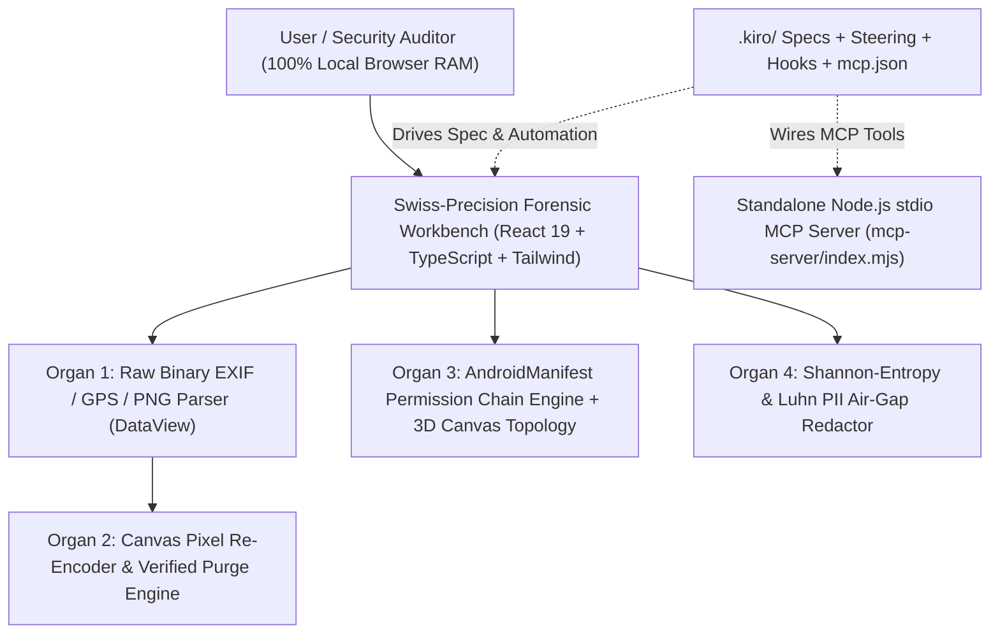
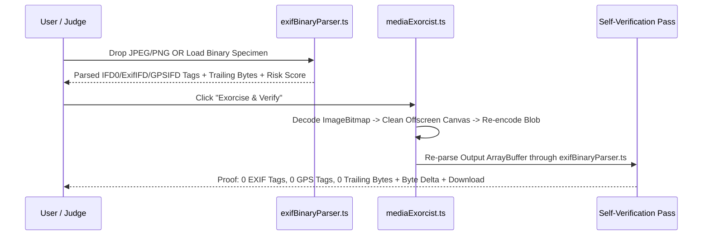

# Technical Design — PhantomGlass Core Platform

## 1. Architecture Overview (Frankenstein 4-Organ Chimera)
PhantomGlass unifies four traditionally separate engineering domains into one cohesive zero-cloud runtime with zero backend servers and zero third-party AI telemetry:

## 2. End-to-End Media Exorcism Sequence

## 3. Core Data Models & Interfaces

- `ExifTagEntry`: `{ id: string; group: 'IFD0' | 'ExifIFD' | 'GPS' | 'PNG_CHUNK' | 'TRAILER'; name: string; value: string; severity: 'CRITICAL' | 'HIGH' | 'MEDIUM' | 'LOW'; }`
- `BinaryForensicReport`: `{ fileName: string; mimeType: string; byteLength: number; format: 'JPEG' | 'PNG' | 'UNKNOWN'; tags: ExifTagEntry[]; gpsCoordinates: { lat: number; lon: number } | null; trailingBytes: number; riskScore: number; hexPreview: string; }`
- `PermissionChainFinding`: `{ id: string; title: string; severity: 'CRITICAL' | 'HIGH' | 'MEDIUM'; permissions: string[]; mechanism: string; realWorldPrecedent: string; adbRevokeCommands: string[]; }`
- `SecretRedactionResult`: `{ redactedText: string; findings: SecretFinding[]; totalSecretsBlocked: number; entropyAnomalies: number; cloudBytesSent: 0; }`

## 4. Security & Zero-Leak Guarantee
- Zero `fetch()` calls to any analytics, telemetry, or third-party AI inference API.
- All binary parsing uses bounds-checked `DataView` reads to prevent out-of-bounds memory exceptions on malformed or crafted files.
- Interactive 3D topology uses pure lightweight 60fps HTML5 2D-projected 3D Canvas math respecting `prefers-reduced-motion` and avoiding heavyweight GPU context loss.
