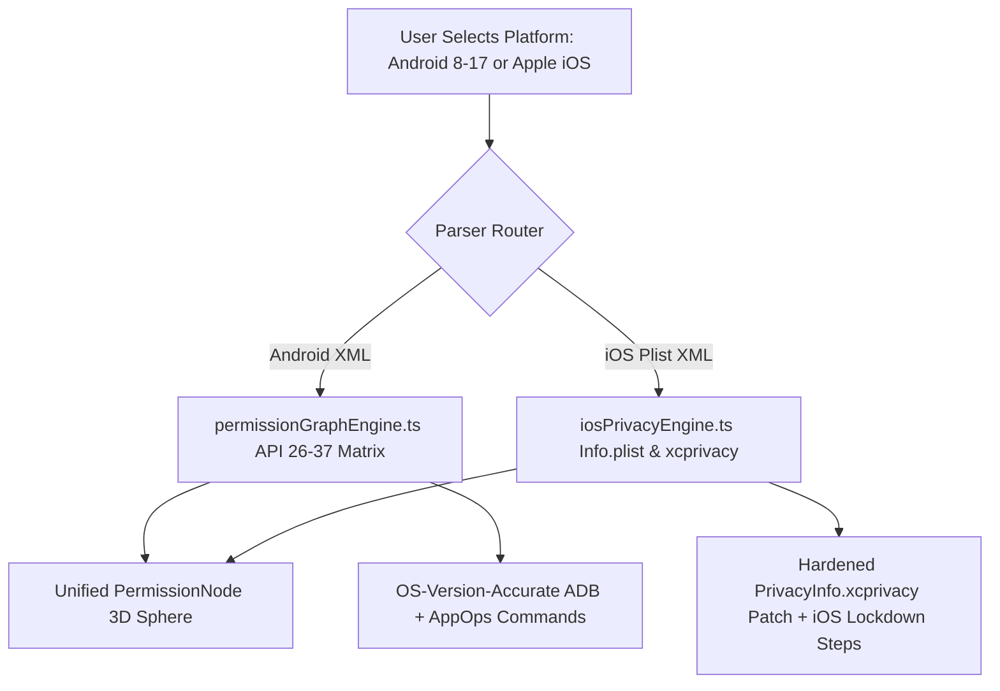

# Design Document — Universal Mobile Privacy Forensics (Android 8–17 + Apple iOS)

## Key Invariants
1. Zero non-runtime install-time permissions (`FOREGROUND_SERVICE_*`, `INTERNET`, `WAKE_LOCK`) ever emitted into `adb shell pm revoke`.
2. Unified `PermissionNode[]` schema drives the exact same 60fps `ThreatTopology3D` sphere seamlessly across both Android 8–17 and Apple iOS.
3. Mirror parity in `mcp-server/index.mjs` via `audit_android_permissions(manifestText, packageName, apiLevel)` and `audit_ios_plist(plistXml)`.
