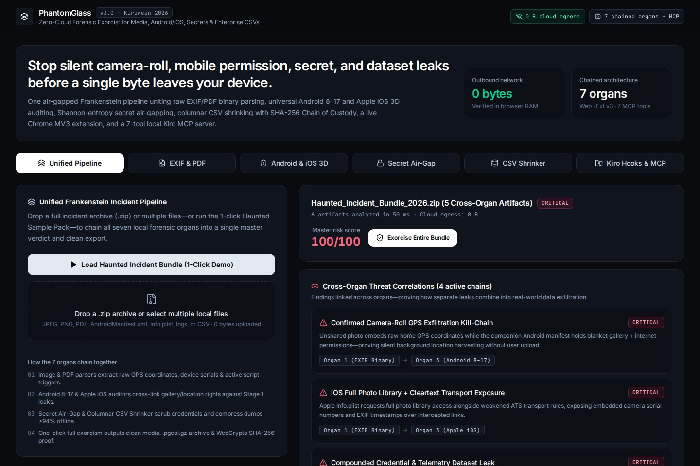
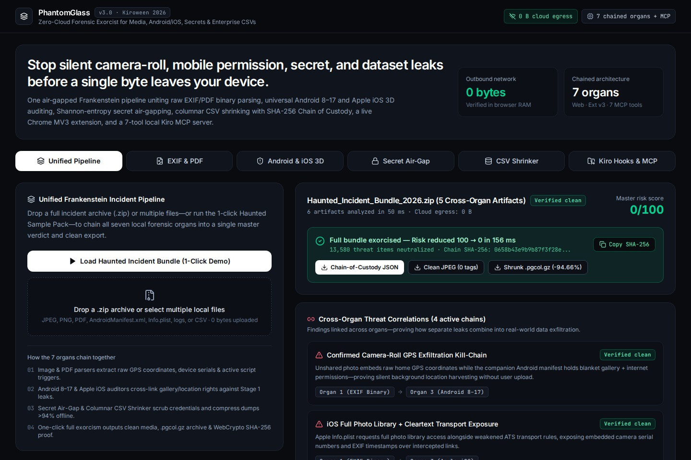
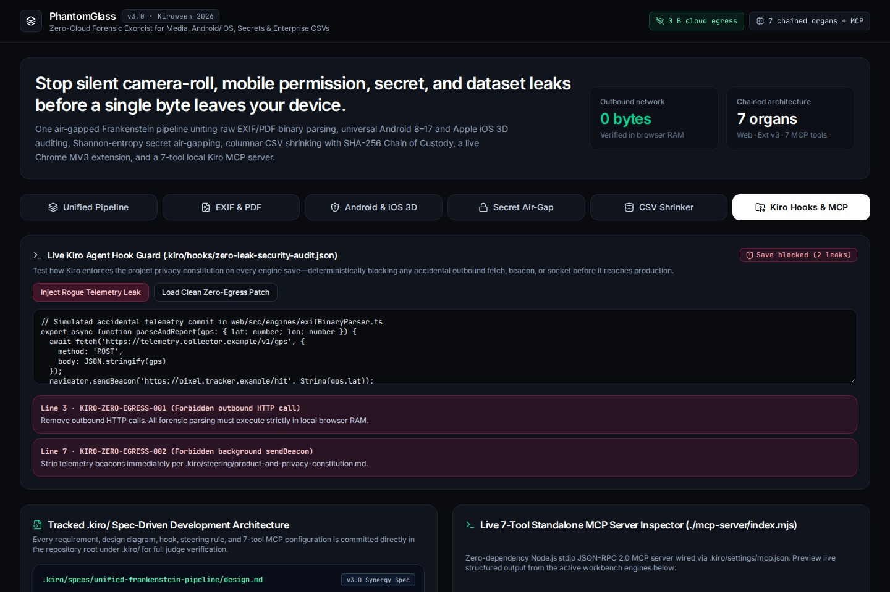
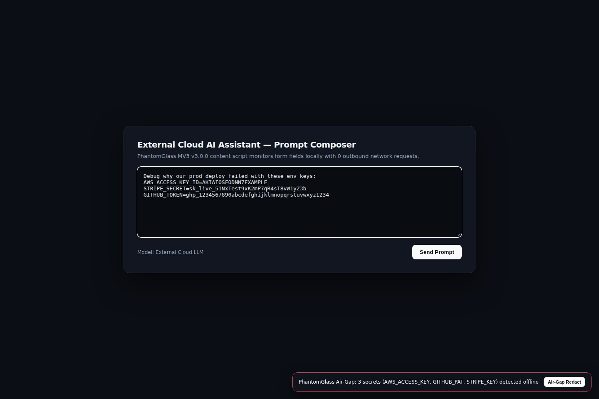

# PhantomGlass v3.1 — Unified 7-Organ Zero-Cloud Frankenstein Forensic Exorcist

[](https://m8ven.ai/mcp/jashory/phantomglass-kiroween)

> **AWS Kiroween 2026 Submission — Frankenstein Category**  
> **Author:** HM Shihabuddin Jashory (`@jashory`) | **Architecture:** Unified 7-Organ Client-Side Forensic Pipeline + Live Kiro Hook Guard (`KIRO-ZERO-LEAK-004/005` Auto-Heal) + Chrome MV3 Inline Air-Gap Extension + 7-Tool Standalone MCP Server

**Live HTTPS Deployment:** [https://jashory.github.io/phantomglass-kiroween/](https://jashory.github.io/phantomglass-kiroween/)  
**Official Demo Video (YouTube 1080p):** [https://youtu.be/sgusVIjMR7M](https://youtu.be/sgusVIjMR7M)  
**Independent M8ven Trust Index Audit (7/7 Tools Verified):** [https://m8ven.ai/mcp/jashory/phantomglass-kiroween](https://m8ven.ai/mcp/jashory/phantomglass-kiroween)  
**Companion Chrome Manifest V3 Extension (`v3.1.0`):** [https://github.com/jashory/phantomglass-kiroween/releases/tag/v3.1.0](https://github.com/jashory/phantomglass-kiroween/releases/tag/v3.1.0)

---

## True Frankenstein Synergy: 7 Independent Organs Chained Into 1 Unified Pipeline

Instead of forcing investigators or hackathon judges to operate six disconnected tabs, **PhantomGlass v3.1** stitches **seven forensic organs into one unified, zero-cloud (`0` outbound bytes) pipeline** in a restrained Swiss-obsidian studio interface:

- **1-Click Haunted Incident Bundle (Zero-Effort Judge Demo) & Multi-File / `.zip` Drop:** Click **Load Haunted Incident Bundle** (or drop your own `.zip` archive or mixed `.jpg`, `.pdf`, `.xml`, `.csv`, `.env` files) to run **all seven organs in one chained pass**:
  1. **Organ #1 — Raw Binary EXIF/GPS & Post-EOI Microscope** (`exifBinaryParser.ts`) extracts GPS coordinates (`23.1667 N, 89.2081 E`), Samsung device fingerprints, and hidden trailing payloads directly from raw `DataView` bytes.
  2. **Organ #2 — Pixel & Metadata Exorcist** (`mediaExorcist.ts`) strips binary metadata via offscreen Canvas re-encoding and re-verifies `0` tags and `0` trailing bytes.
  3. **Organ #3 — Universal Mobile Forensics (Android 8–17 + Apple iOS `Info.plist`) & 3D Topology** (`permissionGraphEngine.ts`, `iosPrivacyEngine.ts`) cross-correlates blanket gallery/location permissions with leaked photo EXIF data and generates version-exact `adb shell pm revoke` + hardened `PrivacyInfo.xcprivacy` patches.
  4. **Organ #4 — Shannon-Entropy & Luhn Secret Air-Gap** (`secretAirGapEngine.ts`) scrubs AWS (`AKIA`), Google/Firebase (`AIza`), OpenAI (`sk-`), HuggingFace (`hf_`), Atlassian (`ATATT`), GitHub, and Stripe credentials, private keys, and payment cards in local RAM.
  5. **Organ #5 — PDF Binary `/OpenAction`, `/JavaScript` & Post-`%%EOF` Microscope** (`pdfForensicEngine.ts`) exposes embedded auto-exec scripts and covert trailing streams.
  6. **Organ #6 — Chrome MV3 v3.1.0 Inline Webpage Air-Gap Extension (`extension/content.js`) & 7-Tool Local Kiro MCP Server (`mcp-server/index.mjs`)**: Actively detects pasted credentials inside live webpage `<textarea>` / `contenteditable` AI prompts and offers a 1-click inline **Air-Gap Redact** banner before text ever hits Send—plus a zero-dependency JSON-RPC 2.0 stdio MCP server.
  7. **Organ #7 — Forensic Columnar Dataset Shrinker & WebCrypto SHA-256 Chain of Custody** (`columnarScrubberEngine.ts`) scrubs PII from CSV logs, packs them into compressed `.pgcol.gz` archives (`90–98%` smaller), and signs a unified **WebCrypto SHA-256 Chain-of-Custody Attestation JSON** proving `0` bytes left the browser.

- **Cross-Organ Kill-Chain Correlation & 1-Click Full Exorcism:** The Unified Pipeline automatically correlates findings across files (e.g., *Android Camera-Roll Exfiltration Chain* linking Organ #1 GPS JPEG + Organ #3 `READ_MEDIA_IMAGES` manifest; *Credential & Document Supply-Chain Leak* linking Organ #4 API keys + Organ #5 PDF `/JavaScript` + Organ #7 CSV logs). Clicking **Exorcise Entire Bundle** neutralizes every organ simultaneously (Risk `100 -> 0` in `156 ms`) and unlocks clean downloads.

---

## Live Kiro Spec-Driven Architecture & Interactive Zero-Egress Hook Guard

All `.kiro/` artifacts live at repository root—and **Tab 5 (`Kiro Hooks & MCP`)** includes an interactive **Live Kiro Agent Hook Interceptor** simulating `.kiro/hooks/zero-leak-security-audit.json` (`KIRO-ZERO-LEAK-001..005` + 1-Click Auto-Remediate): inject a rogue telemetry snippet (`fetch`, `sendBeacon`, `WebSocket`) or hardcoded `AIza` / `_BUILTIN_FB` bundle secret and watch the Kiro hook immediately block the save with exact line diagnostics and 1-click auto-healing before a single outbound byte can ever ship.

- `.kiro/specs/unified-frankenstein-pipeline/design.md` — Unified 7-organ pipeline, `.zip` extraction & kill-chain correlation architecture
- `.kiro/specs/phantomglass-core/`, `.kiro/specs/universal-mobile-forensics/`, `.kiro/specs/columnar-dataset-scrubber/`, `.kiro/specs/binary-exorcist-engine/`
- `.kiro/hooks/zero-leak-security-audit.json` & `.kiro/hooks/spec-sync-guard.json`
- `.kiro/steering/` — Always-on zero-cloud privacy constitution and release gates
- `.kiro/settings/mcp.json` — Pre-wired local `phantomglass-forensics` 7-tool MCP server

### How We Built PhantomGlass With Kiro (Specs -> Steering -> Agent Hooks -> MCP)
- **Spec-Driven Binary Architecture (`.kiro/specs/`):** Rather than vibe-coding fragile regexes, we authored structured Kiro specs (`requirements.md` -> `design.md` -> `tasks.md`) for raw `DataView` EXIF/TIFF/GPS byte offsets, PDF `/OpenAction` stream boundaries, Android API 26–37 + Apple iOS `PrivacyInfo.xcprivacy` diffing, and `.pgcol.gz` columnar compression before generating TypeScript engines.
- **Always-On Zero-Cloud Steering (`.kiro/steering/`):** Enforced an immutable architectural rule forbidding `fetch()`, `XMLHttpRequest`, `navigator.sendBeacon()`, `WebSocket`, and external font/CDN imports across every client-side engine so `0` bytes ever leave local RAM.
- **Self-Healing Kiro Agent Hooks (`.kiro/hooks/zero-leak-security-audit.json`):** Automated pre-save and CI audits (`KIRO-ZERO-LEAK-001..005`) that immediately flag outbound network primitives or hardcoded secrets (`AIza`, `AKIA`, `sk-`) with 1-click auto-remediation.
- **7-Tool Local MCP Server (`.kiro/settings/mcp.json`):** Exposed the exact same forensic pipeline over JSON-RPC 2.0 stdio (`mcp-server/index.mjs`), independently inspected and live-monitored on the **M8ven Trust Index** (`7` tools verified, `0` concerning findings).

---

## Verified v3.1 Live Screenshots (`3:2` High-Resolution Swiss-Obsidian Studio)

| Unified 7-Organ Haunted Bundle (`100/100` Risk) | 1-Click Full Exorcism (`100 -> 0` in `156 ms`) |
| :---: | :---: |
|  |  |

| Live Kiro Agent Hook Guard (`fetch` / `sendBeacon` Blocked) | Chrome MV3 `v3.1.0` Live Webpage Inline Air-Gap |
| :---: | :---: |
|  |  |

---

## Real-World Cloud VM & Cloud Android 14 (API 34) Verification

- **Cloud CI Automated Suite (`tests/forensic-engines.test.mjs`):** Verifies zero `fetch`/`XMLHttpRequest` calls in all `web/src/engines/*.ts`, Android 8–17 + Apple iOS audits, Organ #7 columnar shrinking & SHA-256 chain of custody, 7-tool MCP JSON-RPC 2.0 stdio round-trips, and 6/6 Chaos stress-tests.
- **Cloud Ubuntu VM Live Chromium Verification:** Verifies live HTTPS v3.1 Unified Pipeline (`Haunted Bundle` -> `Exorcise Entire Bundle` -> Risk `0`, `0` console errors, `0` outbound requests) AND loads Chrome Extension `v3.1.0` via `--load-extension` on a live webpage to verify inline `#phantomglass-live-airgap-banner` detection & 1-click redaction.
- **Cloud KVM Android 14 (API 34) Emulator Verification:** Executed all 5 generated `adb shell pm revoke` / `appops set` commands against a signed test APK (`5/5 EXIT CODE 0`, verified `granted=false`).

---

## Quick Verification (Zero External Keys Required)

```bash
# 1. Run automated forensic engine, iOS, Columnar, MCP stdio & zero-leak tests
node --test tests/forensic-engines.test.mjs

# 2. Run the standalone 7-tool MCP server directly over stdio
node ./mcp-server/index.mjs
```

## License
MIT License — Built with Kiro for **AWS Kiroween 2026** by **HM Shihabuddin Jashory (`@jashory`)**.
