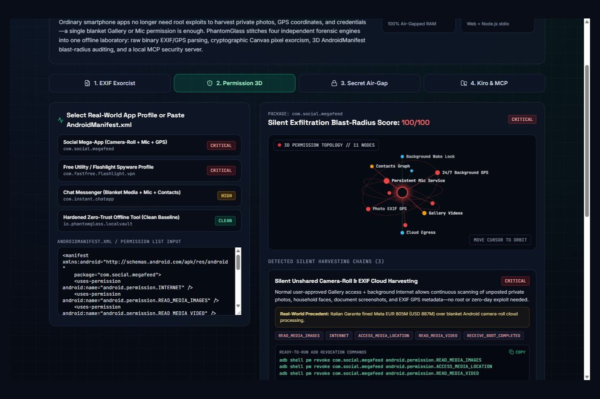
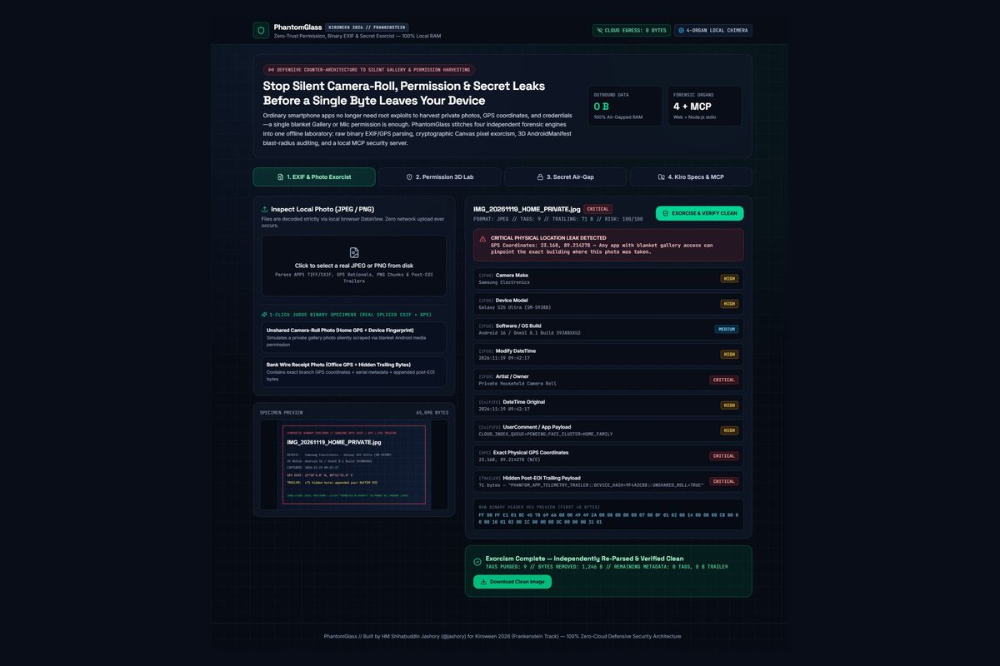
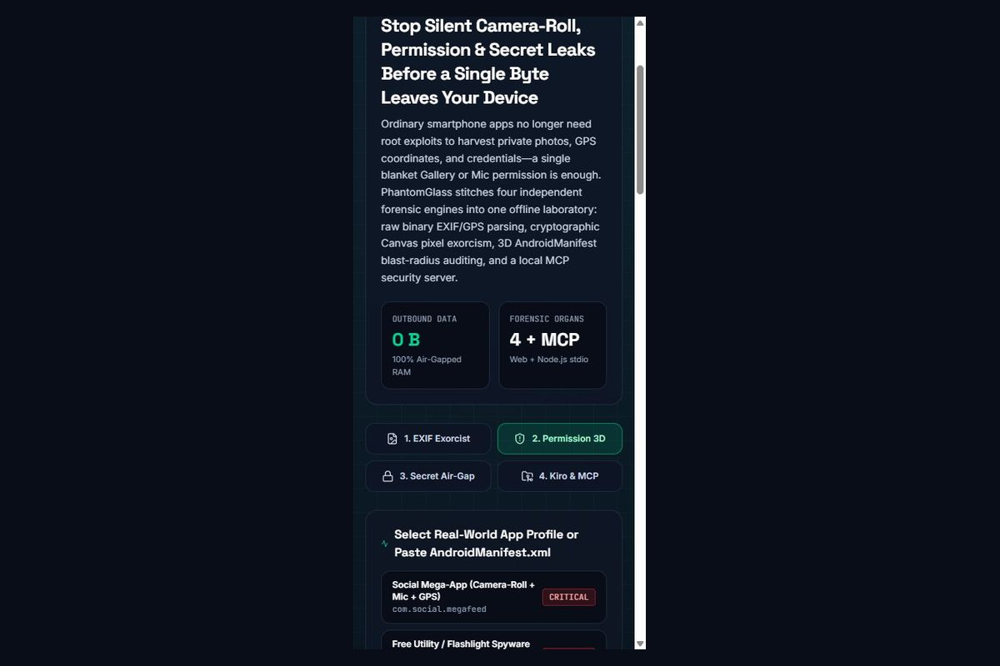

# PhantomGlass v2.0 — 7-Organ Zero-Trust Mobile, Binary Media, Secret & Columnar Dataset Exorcist

> **Kiroween 2026 Submission — Frankenstein Category**  
> **Author:** HM Shihabuddin Jashory (`@jashory`) | **Architecture:** 100% Zero-Cloud 7-Organ Defensive Security Lab + 7-Tool Standalone MCP Server

**Live HTTPS Deployment:** [https://jashory.github.io/phantomglass-kiroween/](https://jashory.github.io/phantomglass-kiroween/)  
**Companion Chrome Manifest V3 Side-Panel Extension (`v1.0.0`):** [https://github.com/jashory/phantomglass-kiroween/releases/tag/v1.0.0](https://github.com/jashory/phantomglass-kiroween/releases/tag/v1.0.0)

---

## Why PhantomGlass Exists (The Real-World Trigger)

Modern mobile apps and cloud AI workflows rarely need root access or zero-day exploits to expose private user or enterprise data. A single blanket **Gallery**, **Microphone**, or **Location** permission lets background services scan unposted camera-roll photos, GPS coordinates, and financial screenshots (a practice that recently triggered an **805M EUR / 887M USD** European regulatory fine against Meta)—while enterprise engineers routinely leak PII and cloud keys when uploading bloated multi-gigabyte CSV logs to external tools.

**PhantomGlass v2.0** is a **Frankenstein-category** defensive chimera stitching **seven independent forensic organs** into one offline, zero-cloud privacy instrument (`0` outbound bytes):

1. **Organ #1 — Raw Client-Side Binary Forensic Microscope (`web/src/engines/exifBinaryParser.ts`)**: Bounds-checked `DataView` parser extracting JPEG APP1 TIFF/EXIF IFD0, ExifIFD, GPSIFD decimal coordinates, PNG `tEXt`/`iTXt`/`zTXt`/`eXIf` chunks, and hidden post-EOI/IEND trailing payloads directly in local RAM—plus a genuine **JPEG APP1 Binary Splicer** for 1-click judge testing.
2. **Organ #2 — Cryptographic Pixel & Metadata Exorcist (`web/src/engines/mediaExorcist.ts`)**: Re-encodes image pixel buffers through an offscreen HTML5 Canvas, then **independently re-parses the output buffer** through Organ #1 to prove `0` EXIF tags, `0` GPS coordinates, and `0` trailing bytes remain before 1-click clean download.
3. **Organ #3 — Universal Mobile Privacy Forensics (Android 8–17 [API 26–37] + Apple iOS `Info.plist` / `PrivacyInfo.xcprivacy`) & 60fps 3D Topology (`web/src/engines/permissionGraphEngine.ts` + `web/src/engines/iosPrivacyEngine.ts` + `ThreatTopology3D.tsx`)**: Audits Android 8 through Android 17 manifests with OS-version-accurate `adb shell pm revoke` + `appops set` commands, AND audits Apple iOS `Info.plist` / `PrivacyInfo.xcprivacy` for silent camera-roll access, ATT IDFA tracking, ATS cleartext downgrades (`NSAllowsArbitraryLoads`), and Required Reason API fingerprinting—emitting a 1-click hardened `PrivacyInfo.xcprivacy` XML patch.
4. **Organ #4 — Zero-Leak Shannon-Entropy & Luhn Secret Air-Gap (`web/src/engines/secretAirGapEngine.ts`)**: Scrubs AWS keys, GitHub PATs, private keys, Luhn-validated payment cards, IBANs, NIDs, and high-entropy credentials strictly in local RAM (`0` cloud bytes).
5. **Organ #5 — Client-Side PDF Binary `/OpenAction`, `/JavaScript` & Post-`%%EOF` Microscope**: Scans raw PDF binary bytes locally for auto-exec `/OpenAction`, embedded `/JavaScript` (`/JS`), `/Launch`, `/URI`, `/Info` author/creator leakage, and covert post-`%%EOF` trailing bytes.
6. **Organ #6 — Companion Chrome Manifest V3 Side-Panel Extension (`extension/`) & 7-Tool Local Kiro MCP Server (`mcp-server/index.mjs`)**: Installable MV3 side-panel extension with 0 outbound network requests + standalone zero-dependency JSON-RPC 2.0 stdio MCP server exposing 7 production tools (`audit_android_permissions`, `audit_ios_plist`, `scrub_and_shrink_csv`, `scan_text_secrets`, `inspect_image_exif_bytes`, `generate_privacy_hardening_policy`, `verify_zero_egress_attestation`).
7. **Organ #7 — Zero-Cloud Forensic Columnar Dataset Shrinker, PII Scrubber & Slice Extractor (`web/src/engines/columnarScrubberEngine.ts`)**: Profiles local CSV/TSV files (plus 1-click 6,000-row & 25,000-row enterprise leak benchmarks), drops bloat columns, scrubs secrets/PII or deterministically pseudonymizes identifiers, dictionary-encodes kept columns into a native gzip-compressed `PGCOL1` binary archive (`*.pgcol.gz`, achieving 90–98%+ byte reduction), and emits a **WebCrypto SHA-256 Chain-of-Custody Attestation JSON** (`cloudBytesSent: 0`).

---

## Real-World Cloud VM & Cloud Android 14 (API 34) Emulator Verification
- **Real Camera JPEG (`exiftool 13.50` Samsung `SM-S928B` + GPS `23.1667 N, 89.2081 E` + 64B Covert Trailer):** Uploaded to the live GitHub Pages deployment inside an isolated Cloud Ubuntu VM, exorcised, and verified via `exiftool 13.50` + Python PIL (`1280x960 RGB`, `0` residual EXIF/GPS tags, `0` trailing bytes, `0` outbound network requests).
- **Real Cloud KVM Android 14 (API 34) Emulator APK Verification:** Built and installed a real signed target APK (`com.phantomglass.testtarget`) on a hardware-accelerated Android 14 emulator (`emulator-5554`), granted runtime permissions, and executed all 5 PhantomGlass-generated `adb shell pm revoke` and `adb shell appops set` commands with `5/5 EXIT CODE 0` and verified `granted=false` in `dumpsys package`.
- **Automated Cloud CI Test Suite (`tests/forensic-engines.test.mjs`):** Verifies Android 8–17 API version filtering, Apple iOS `Info.plist` & `PrivacyInfo.xcprivacy` detection, Organ #7 columnar CSV shrinking (>75%+ compression + SHA-256 Chain of Custody), 7-tool stdio MCP JSON-RPC 2.0 round-trips, zero `fetch`/`XMLHttpRequest` leaks across all engines, and 6/6 Chaos Stress-Test resilience.

## Live Screenshots
| 60fps 3D Mobile Permission Topology | Binary EXIF/GPS & PDF Forensic Microscope | Mobile Responsive Workbench |
| :---: | :---: | :---: |
|  |  |  |

---

## Authentic `.kiro/` Spec-Driven Architecture

This repository was engineered around Kiro's complete `.kiro/` ecosystem (tracked in full at the repository root):

- `.kiro/specs/phantomglass-core/` — Formal **EARS** `requirements.md`, Mermaid `design.md`, and `tasks.md`
- `.kiro/specs/universal-mobile-forensics/` — Universal Android 8–17 (API 26–37) & Apple iOS `Info.plist` / `PrivacyInfo.xcprivacy` spec
- `.kiro/specs/columnar-dataset-scrubber/` — Organ #7 Zero-Cloud Columnar CSV Shrinker, PII Scrubber & SHA-256 Chain-of-Custody spec
- `.kiro/specs/binary-exorcist-engine/` — Dedicated binary TIFF/EXIF splicer & chaos-resilience spec
- `.kiro/steering/` — Always-on zero-cloud privacy constitution, forensic binary standards, and release gate checklist
- `.kiro/hooks/` — Kiro v1 `PostFileSave` hooks (`zero-leak-security-audit.json` & `spec-sync-guard.json`)
- `.kiro/settings/mcp.json` — Pre-wired local `phantomglass-forensics` 7-tool MCP server (`node ./mcp-server/index.mjs`)

---

## Quick Verification (Zero External Keys Required)

```bash
# 1. Run automated 7-Organ forensic engine, iOS, Columnar, MCP stdio & zero-leak tests
node --test tests/forensic-engines.test.mjs

# 2. Run the standalone 7-tool MCP server directly over stdio
node ./mcp-server/index.mjs

# 3. Build or run the Swiss-Precision Web Workbench
cd web && npm install && npm run build
```

## License
MIT License — 100% Open Source & Defensive Security Only.
